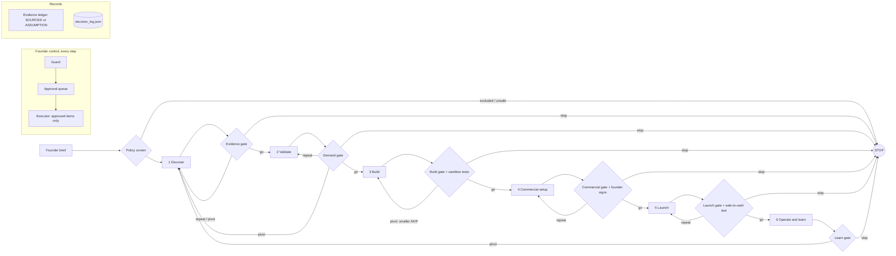
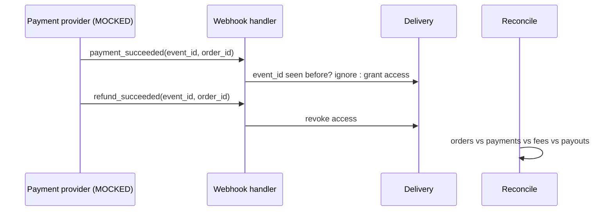

# Architecture

The key facts for each part come first; every threshold, per-phase diagram and the run state machine are in [docs/architecture-details.md](docs/architecture-details.md).

## Overview

Founder Agents is a team of single-purpose agents run by an explicit state machine (`app/orchestrator.py`). A run starts from a founder brief, passes a policy screen, then moves through six phases. Every step ends in a gate: a pre-set threshold, tests that must pass, or a founder approval. Every phase ends in a gate that recommends **go**, **repeat**, **pivot** or **stop** from thresholds fixed before the evidence, and the founder decides. Agents only draft; anything that leaves the system (publish, send, spend, sign) becomes an item in the approval queue (`app/approval.py`), whose executor refuses anything the founder did not approve. Every action is appended to `decision_log.json`. Key drafts pass a specificity critic in code (`app/specificity.py`): stock advice, or a draft that ignores the founder's budget, hours, skills and market, is sent back once with the problems listed, and each gate ends with a next step built from the run's own numbers (`app/next_steps.py`). Checkout, public hosting, posting and sending are MOCKED: the system never takes money or acts on the founder's accounts.



## Phases

### Phase 1: Discover
- **Core step:** Find opportunities.
- **Area check first:** if the founder says where they will sell, the researcher adds 2 searches about that place and `area_analyst` judges local fit, whether what the product needs is available there (language, content, access, channels) and where the idea would stand among local and global competitors; `cap_fit` keeps the fit UNKNOWN unless a retrieved source supports a claim about the place. Output: `phase1_step0_area_check`; the opportunities and the co-founder verdict read it.
- **Agents:** `researcher` (3 queries from the brief), `scout` (up to 3 opportunities scored 1-5 on pain, founder fit, feasibility, reach, differentiation), `market_analyst` (customer, segments, where they gather), `interviewer` (Mom Test script with a "problem confirmed" rule, plus an outreach draft).
- **Tools:** Hacker News, Stack Exchange, Wikipedia and DuckDuckGo (free, no keys) and founder URLs (`app/research.py`), interleaved so no source fills the budget.
- **Method:** `app/evidence.py` keeps a citation only if that source was retrieved in this run and supports the claim; otherwise the claim is labelled ASSUMPTION. Excluded opportunities are re-screened in code and never chosen.
- **Co-founder verdict:** after the gate, `cofounder` judges the opportunity (strong / promising / weak / do not pursue), names the killer risk and proposes 2-4 concrete improvements with the cheapest test for each; `cap_verdict` keeps it no more positive than the gate (repeat → at most promising, pivot → weak, stop → do not pursue). It also gives the best launch window (concrete dates after today, from the customers' calendar and the founder's hours) and what to avoid. Output: `phase1_step4_cofounder_verdict`.
- **Funding scout (strong or promising only):** 3 searches about grants, accelerators and competitions near the founder; `funding_scout` lists funders with their criteria met and missed; code computes fit % = met / checked (a match score, never a probability), marks names absent from the sources UNVERIFIED, shows an apply link only if it appears in a source, and drops banks and loans. The outreach email is a draft only. Output: `phase1_step5_funding`.
- **Gate:** outreach is a `send` approval (the founder sends it personally); the evidence gate needs ≥3 sourced claims, ≥40% sourced, ≥2 independent sources showing the pain and a best score ≥3/5.
- **Output:** `phase1_step1_opportunities`, `phase1_step2_market`, `phase1_step3_interview_plan`, `phase1_gate_decision`.

### Phase 2: Validate
- **Core step:** Design the business.
- **Agents:** `strategist` (Lean Canvas, riskiest assumptions first), `marketer` (landing copy only), `analyst` (demand targets), `interview_analyst` (Mom Test analysis of each real interview).
- **Method:** our template renders the landing page, so it cannot carry scripts, timers, testimonials or payment fields; every line passes the guard. After a `publish` approval the page runs at `/lp/<run>` and counts real sign-ups. The founder locks the targets **before** any result exists. Each real interview (pasted notes, or a recording transcribed by open-weight Whisper) goes to `interview_analyst`, which applies the plan's "problem confirmed if" rule, separates evidence from compliments and hypotheticals, and suggests the next questions; code keeps only quotes found in the transcript and overturns a confirmation without one (`app/interviews.py`). The counts pre-fill the demand gate; the founder can still edit them.
- **Gate:** demand gate on sign-ups, interviews and the share confirming the problem, against the locked targets.
- **Output:** `phase2_step1_lean_canvas`, `phase2_step2_landing_page`, `phase2_step3_demand_test`, `phase2_step4_interviews`, `phase2_gate_decision`.

### Phase 3: Build
- **Core step:** Build the product: a tested MVP with user docs.
- **Agents:** `builder` (MVP spec: 2-5 user stories with Given/when/then criteria, must-have features traced to stories, hours against the founder's budget, screens), `coder` (core functions for every user story plus one check per criterion); QA is code.
- **Tools:** `app/sandbox.py`: static allowlist (pure standard library; no file, network, process or introspection calls), then a separate isolated process with time and resource limits.
- **Method:** a clickable prototype from our template (`/proto/<run>`); the coder's checks run in the sandbox with one repair; a criterion that needs storage, a UI or hosting is listed as DEFERRED, never faked (the orchestrator lists any criterion the coder left out). When every check passes, the founder builds the MVP app (`app/mvp_app.py`, `/mvp/<run>`): each request runs the tested functions in the sandbox, nothing is stored. The same build writes the **user guide** in code from the spec, the tested code and a real sandbox run (no model call), served at `/mvp/<run>/guide`.
- **Gate:** build gate (≥2 stories, all testable, features traced, ≤6 must-haves, hours ≤ budget, prototype safe); sandbox checks must pass; one `publish` approval for app and guide.
- **Output:** `phase3_step1_mvp_spec`, `phase3_step2_prototype`, `phase3_step3_acceptance_tests`, `phase3_step4_code`, `phase3_step5_mvp_app`, `phase3_step6_user_guide`, `phase3_gate_decision`.

### Phase 4: Commercial setup
- **Core step:** Set the price and policies. No payments of any kind.
- **Agents:** `pricer` (1-3 tiers, comparables, a way to test willingness to pay without taking money), `policy_drafter` (terms, privacy and refund DRAFTS; privacy lists the data the MVP handles).
- **Method:** comparable prices go through the evidence ledger (SOURCED or ASSUMPTION); policies may say "results are not guaranteed" but never promise. The core feature must stay in a free tier.
- **Gate:** commercial gate (core free, ≥2 comparables, price basis disclosed, 3 complete drafts, 0 guard flags); **GO is refused in code** until the founder signed the pricing and all three policies.
- **Output:** `phase4_step1_pricing`, `phase4_step2_policies`, `phase4_gate_decision`.

### Phase 5: Launch
- **Core step:** Open the store; deliver automatically (MOCKED).
- **Agents:** `launcher` (store copy, honest FAQ, one post per channel in the founder's voice, launch targets); delivery is code (`app/sale_to_cash.py`).
- **Method:** our template renders the store with prices taken from the signed Phase 4 plan, never from the model; the paid tier says "Not on sale yet: payments are MOCKED". Posts are guarded and posted by the founder personally. Before the gate, the sale-to-cash test runs on MOCKED events (see Sale to cash).
- **Gate:** launch gate (store safe, prices equal the signed plan, posts pass, policies signed, sale-to-cash test PASS); **GO is refused in code** until the founder approved the store page and locked the launch targets.
- **Output:** `phase5_step1_store_page`, `phase5_step2_launch_kit`, `phase5_step3_payment_test`, `phase5_gate_decision`, `payment_test_log.md`.

### Phase 6: Operate and learn
- **Core step:** none (ongoing).
- **Agents:** `support` (an honest reply draft per piece of real feedback; never promises refunds or asks for payment details), `analyst` (learning memo, written after the gate and unable to change it).
- **Method:** sign-ups, store visits, MVP views and runs are counted by the app itself (page and date only; no cookies or IPs); replies are `send` approvals the founder sends personally.
- **Gate:** learn gate against the targets locked before launch: all met → go (persevere); sign-ups ≥50% → repeat; ≥25% or feedback naming the problem → pivot; else **stop**.
- **Output:** `phase6_step1_metrics`, `phase6_step2_support_replies`, `phase6_gate_decision`, `phase6_step3_learning_memo`.

## Gates

| Gate | Checks (fixed before the evidence) | Outcomes |
|---|---|---|
| Policy screen | Excluded products (physical, financial/crypto, health or legal advice); unsafe requests | stop |
| 1 Evidence | ≥3 sourced claims; ≥40% sourced; ≥2 independent sources show the pain; best score ≥3/5 | go / repeat / pivot / stop |
| 2 Demand | Sign-ups, interviews and problem-confirmation share vs targets the founder locked first | go / repeat / pivot / stop |
| 3 Build | Testable stories, traced features, ≤6 must-haves, hours ≤ budget, prototype safe; sandbox checks pass | go / repeat / pivot / stop |
| 4 Commercial | Core feature free, ≥2 comparables, price basis, 3 policy drafts, 0 guard flags, founder signed all | go / repeat / stop |
| 5 Launch | Store safe, prices = signed plan, posts pass, targets locked, sale-to-cash test PASS | go / repeat / stop |
| 6 Learn | Visits and sign-ups vs locked targets; ≥3 users gave feedback | go / repeat / pivot / stop |

**Every step ends with a gate:** a pre-set threshold (evidence ledger, guard, gate checks), passing tests (sandbox acceptance checks, the sale-to-cash test), or a founder approval (outreach, landing page, prototype, MVP app and guide, pricing and policy sign-off, store page, each post, launch targets, each support reply). The step-by-step table is in [docs/architecture-details.md](docs/architecture-details.md#gates).

**When the system recommends STOP:**
- The product is excluded, before any agent runs.
- Discover fails three or more evidence checks, or a second pass still has fewer than 2 sources showing the pain (one retry, then stop).
- Validate: fewer than half the target share confirm the problem, or sign-ups are under 25% of target and interviews also miss. Example: target 100 sign-ups in 14 days, 12 arrive → **stop**, not "promising early traction".
- Build, Commercial or Launch still fail after one redraft.
- Operate: sign-ups under 25% of the locked target and feedback does not name the core problem.

The gate memo is written after the recommendation and cannot change it. The founder may overrule a recommendation, but only with a written reason: the decision is refused in code without one, and the log and the gate output keep the recommendation, the decision and the reason (`founder_override: true`).

## Sale to cash

Runs in Phase 5 before the launch gate, on **MOCKED** events only (`app/payments.py`, `app/delivery.py`, `app/refunds.py`, `app/reconcile.py`; result in `outputs/payment_test_log.md`). No provider, sandbox, card data or money is involved.



- **Payment triggers delivery:** only a `payment_succeeded` event grants access; the system never takes payment itself.
- **A refund revokes access:** `refund_succeeded` turns access off for that order; refunds are issued by the founder in their own provider.
- **Idempotency:** each event id is processed once; a webhook retry returns `duplicate_ignored`, so nothing is delivered twice.
- **Reconciliation:** every paid order has a matching payment; payouts = gross − fees − refunds; mismatches are reported, never auto-corrected.

## Data flow

```
brief ─> guard ─> researcher ─> [S1..Sn sources, sanitized] ─> scout / market_analyst / strategist
                                                   │ claims + source ids
                                                   v
                                  evidence ledger: SOURCED (url) | ASSUMPTION
agents' drafts ─> guard.check_output ─> approval queue ─(founder approves)─> executor
gate thresholds + real results ─> recommendation ─> founder decision
every action ─> decision_log.json (timestamp, agent, action, sources, model, cost, approved_by, hash chain)
artifacts ─> outputs/phase<N>_step<M>_<name>-<run>.<ext>      run state ─> data/runs/<id>/state.json
```

Web text and model output are untrusted: sources are sanitized, model output is schema-checked and guarded. The model is reached only through `app/llm.py` (local Ollama, or a free-tier endpoint serving open weights, falling back to the local model when rate-limited; the log names the model that answered).

## Built vs. stubbed

| Component | Status |
|---|---|
| State machine, agents for all six phases, evidence ledger, gates, approval queue, guard, decision log with hash chain, web UI, CLI | Built |
| MVP: core code for every user story tested in the sandbox, MVP app and user guide | Built (served locally) |
| Replay of recorded runs (`/replay/<run>`), founder export, run metrics, claims audit, red-team evaluation | Built |
| Public hosting of landing page, prototype, MVP app and store | MOCKED |
| Sending outreach and support replies, posting launch posts | MOCKED (the founder does it personally) |
| Checkout and payment provider; payment → delivery, refunds, idempotency, reconciliation | MOCKED events, real logic |
| MVP storage, accounts, and the DEFERRED criteria that need them | STUBBED |

## Roadmap

1. MVP storage and file handling in a no-network container sandbox, so DEFERRED criteria get executable checks.
2. A price lookup tool so more comparable prices are SOURCED.
3. After the hackathon: a webhook handler for a provider in the founder's own account (founder's keys, never ours) to replace the MOCKED events.
4. Activation and retention per MVP feature once the app is hosted publicly.
5. Community: more free research tools, red-team prompts in `evals/`, translations (Arabic first); see [CONTRIBUTING.md](CONTRIBUTING.md).
