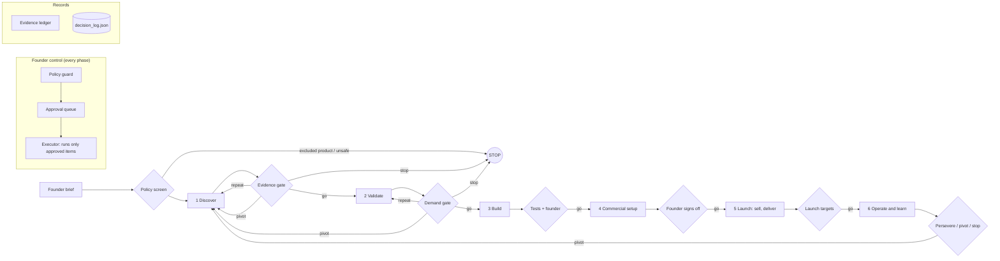
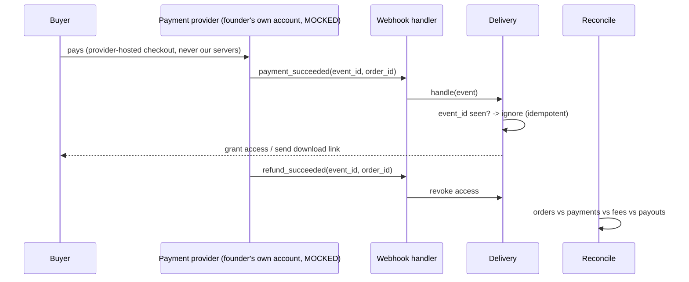

# Architecture

## Overview

Founder Agents is a team of single-purpose agents coordinated by an explicit state machine. A run starts from a founder brief, passes a policy screen, then moves phase by phase. Every phase ends in a gate: a recommendation computed from thresholds fixed in advance (or tests passing), followed by the founder's decision: **go**, **repeat**, **pivot** or **stop**. Agents only draft; anything that leaves the system (publish, send, spend, sign) becomes an item in the approval queue, and the only code path that executes it refuses unless the founder approved it. All agent actions append to `decision_log.json`. Phases 1-2 are built; phases 3-6 are designed here and STUBBED or MOCKED in the prototype.



## Phases

### Phase 1: Discover (built)
- **Core step:** Find opportunities.
- **Agents:** `researcher` (plans queries, gathers sources), `scout` (find and score opportunities), `market_analyst` (define the market), `interviewer` (Mom Test plan).
- **Tools:** Hacker News Algolia API, Stack Exchange API, DuckDuckGo HTML, founder-supplied URLs (`app/research.py`). All free, no keys.
- **Method:** the researcher turns the brief into 3 queries; sources get ids (`S1`...). The scout derives up to 3 opportunities from the founder's idea and scores each 1-5 on pain, founder fit, feasibility within budget and hours, reach and differentiation against current alternatives. The market analyst defines the ideal customer, segments, where they gather and the unknowns. The interviewer writes a Mom Test script (past behaviour, no pitching) with an observable "problem confirmed" rule, plus an outreach draft signed by the founder, queued as a `send` item.
- **Evidence rule (code):** `app/evidence.py` keeps a citation only if the source id was retrieved in this run and the source text shares key terms with the claim. Otherwise the claim is labelled `ASSUMPTION`.
- **Output:** `phase1_step1_opportunities-*.md`, `phase1_step2_market-*.md`, `phase1_step3_interview_plan-*.md`, `phase1_gate_decision-*.md`.

### Phase 2: Validate (built)
- **Core step:** Design the business.
- **Agents:** `strategist` (Lean Canvas), `marketer` (landing-page copy), `analyst` (demand targets).
- **Method:** the Lean Canvas orders the riskiest assumptions. The marketer writes copy only; our template renders the page, so it cannot carry scripts, timers, testimonials, traction numbers or payment fields, and each line is re-checked by the guard. Publishing is a `publish` item; after approval the page is served at `/lp/<run>` and its form counts real sign-ups. The analyst proposes targets (sign-ups in N days, interviews, share confirming the problem); the founder locks them **before** results exist. The founder then enters real interview results; sign-ups come only from the form.
- **Output:** `phase2_step1_lean_canvas-*.md`, `phase2_step2_landing_page-*.html`, `phase2_step3_demand_test-*.md`, `phase2_gate_decision-*.md`.

### Phase 3: Build (STUBBED)
- **Core step:** Build the product.
- **Agents:** `builder` (generates the MVP in a sandboxed workspace from the Lean Canvas solution), `qa_tester` (writes and runs tests), `doc_writer` (user docs).
- **Tools:** a local code model via Ollama, a container sandbox with no network by default, pytest/playwright.
- **Gate:** tests pass and the founder approves the release candidate. Failing tests → repeat; scope beyond budget/hours → pivot to a smaller MVP.

### Phase 4: Commercial setup (STUBBED)
- **Core step:** Set the price and policies.
- **Agents:** `pricer` (price points from sourced comparables, or labelled assumptions; at least one free tier for the core feature), `policy_drafter` (terms, privacy and refund policy drafts marked DRAFT).
- **Gate:** the founder approves the price and signs off each policy (a `sign` item). No payments of any kind are configured.

### Phase 5: Launch: sell, deliver, get paid (MOCKED / STUBBED)
- **Core step:** Open the store; deliver automatically.
- **Agents:** `launcher` (store page and launch posts as `publish` items, one per channel), `delivery` (grants access on a payment event).
- **Method:** see Sale to cash. Launch posts are written in the founder's voice for the founder's own accounts and published only after approval; the system never creates accounts.
- **Gate:** launch targets set before launch (visits, conversion, delivered orders) plus a passing `payment_test_log.md`.

### Phase 6: Operate and learn (STUBBED)
- **Core step:** none (ongoing).
- **Agents:** `support` (drafts replies for approval), `metrics` (activation, retention, refunds vs targets), `analyst` (persevere-or-pivot memo).
- **Gate:** metrics vs targets → persevere, pivot (back to Discover with what was learned) or stop.

## Gates

| Gate | Checks (targets fixed before evidence) | Outcomes |
|---|---|---|
| Policy screen | Excluded product types; unsafe requests | stop |
| Phase 1 evidence gate | ≥3 sourced claims; ≥40% of claims sourced; ≥2 independent sources showing the pain; best opportunity score ≥3/5 | go / repeat / pivot / stop |
| Phase 2 demand gate | Waitlist sign-ups ≥ target in window; interviews ≥ target; share confirming the problem ≥ target | go / repeat / pivot / stop |
| Phase 3 build gate | Tests pass; founder approves | go / repeat / pivot |
| Phase 4 commercial gate | Founder approves price and signs each policy | go / repeat |
| Phase 5 launch gate | Launch targets; payment test log passes | go / repeat / pivot / stop |
| Phase 6 learn gate | Retention and refund targets | persevere / pivot / stop |

**When the system recommends STOP** (`app/gates.py`):
- The product is excluded (physical, financial/crypto, health or legal advice), before any agent runs.
- Discover: three or more evidence checks fail, or no source shows the pain and the opportunity scores below 3/5.
- Discover, second pass: after one repeat or pivot, still fewer than 2 independent sources show the pain. One retry is allowed; a second failing pass is a stop, not another retry.
- Validate: interviews are complete but fewer than half the target share confirm the problem, or sign-ups are under 25% of target and interviews also miss.
- Example: target 100 sign-ups in 14 days, 12 arrive and interviews miss → **stop**, not "promising early traction".

The gate memo is written after the recommendation is computed and may not change it. The founder may override; the log keeps both the recommendation and the decision (`founder_override: true`).

## Sale to cash

Designed for phase 5; the logic runs today on **MOCKED** events (`app/payments.py`, `app/delivery.py`, `app/refunds.py`, `app/reconcile.py`, test in `outputs/payment_test_log.md`). No provider, sandbox, card data or money is involved.



- **Payment triggers delivery:** only a provider `payment_succeeded` event grants access; the system never takes payment itself.
- **Refund revokes access:** `refund_succeeded` flips access off for that order. Refunds are issued by the founder in their provider; we react to the event.
- **Idempotency:** each provider event id is processed once; a webhook retry returns `duplicate_ignored`, and an order already delivered is never delivered twice.
- **Reconciliation:** every paid order has a matching payment of the same amount; sum of (amount − fee) over non-refunded orders equals payouts; mismatches are reported, not auto-corrected.

## Data flow

```
brief ──> guard ──> researcher ──> [S1..Sn sources] ──> scout / market_analyst / strategist
                                                          │ claims (text + source ids)
                                                          v
                                            evidence ledger: SOURCED (url) | ASSUMPTION
                                                          │
             agents' drafts ──> guard.check_output ──> approval queue ──(founder approves)──> executor
                                                          │
                       gate thresholds + real results ──> gate recommendation ──> founder decision
                                                          │
   every step ──> decision_log.json (timestamp, agent, action, sources, model, cost, approved_by, hash chain)
   artifacts ──> outputs/phase<N>_step<M>_<name>-<run>.<ext>       run state ──> data/runs/<id>/state.json
```

Persistence is plain files (JSON, CSV, Markdown) so runs are inspectable and portable. The model is reached only through `app/llm.py` (Ollama HTTP, JSON-schema output, token counting).

## Built vs. stubbed

| Component | Status |
|---|---|
| Orchestrator state machine, phases 1-2 agents, evidence ledger, gates 1-2, approval queue, guard, decision log, web UI, CLI | Built |
| Landing page publishing | Built locally; public hosting MOCKED |
| Outreach sending | MOCKED (founder sends personally) |
| Payment → delivery, refunds, idempotency, reconciliation | MOCKED events, real logic |
| Phase 3 Build, Phase 4 Commercial setup, Phase 5 store page and posts, Phase 6 Operate | STUBBED (reports in `outputs/` when a run reaches them) |

## Roadmap

1. Phase 3: builder agent in a no-network container sandbox, with tests as the gate.
2. Phase 4: pricer with sourced comparables; policy drafts with a "review with a lawyer" sign gate.
3. Phase 5: store page and launch posts as approval items; webhook handler for a real provider in the founder's own account (founder-configured, never our keys).
4. Phase 6: metrics dashboard from real product events; persevere-or-pivot memo.
5. Community: more free research tools, more red-team prompts in `evals/`, translations (Arabic first).
