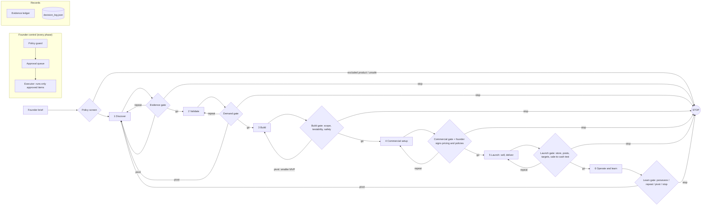
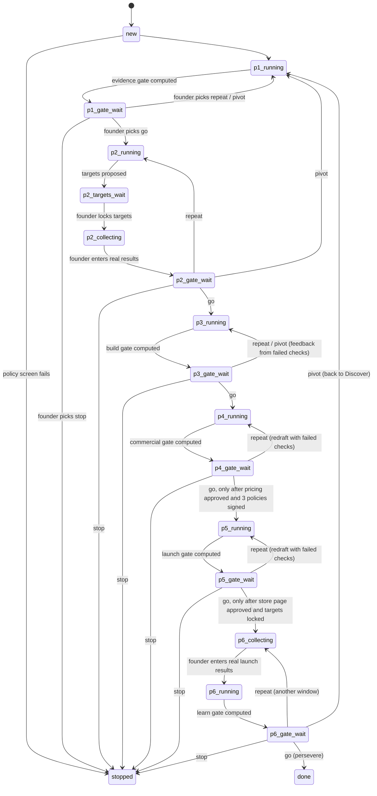
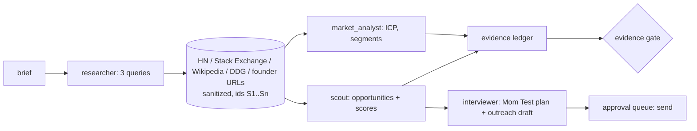
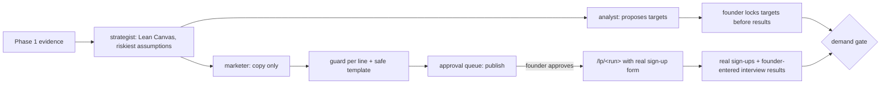
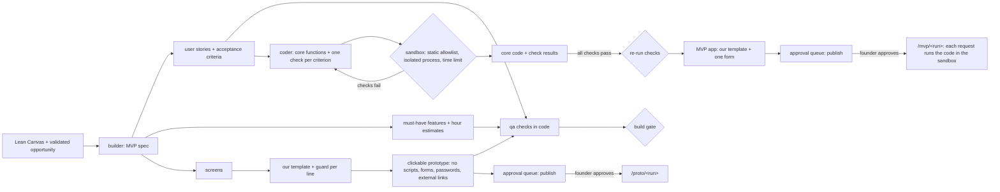
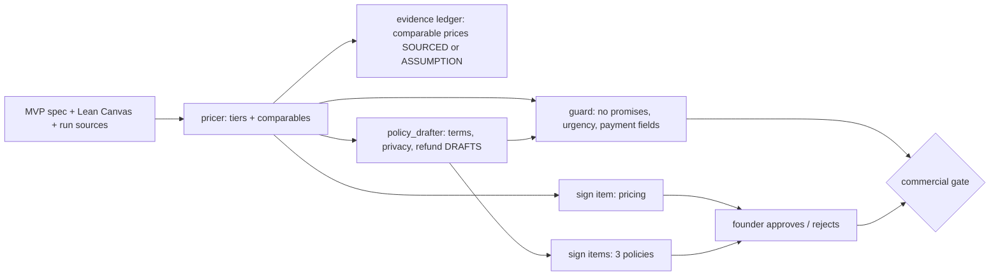
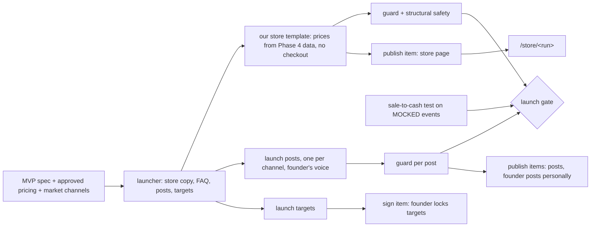
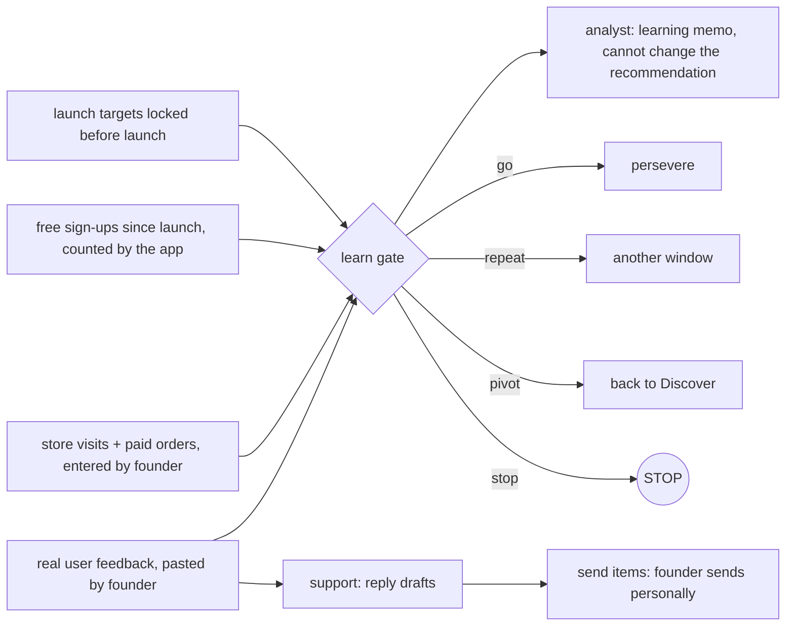
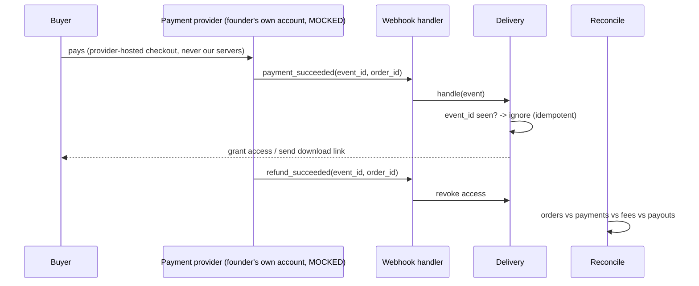

# Architecture details

Full, step-by-step detail behind [ARCHITECTURE.md](../ARCHITECTURE.md): per-phase diagrams, the run state machine, every gate threshold and every STOP rule.

## Overview

Founder Agents is a team of single-purpose agents coordinated by an explicit state machine. A run starts from a founder brief, passes a policy screen, then moves phase by phase. Every phase ends in a gate: a recommendation computed from thresholds fixed in advance (or tests passing), followed by the founder's decision: **go**, **repeat**, **pivot** or **stop**. Agents only draft; anything that leaves the system (publish, send, spend, sign) becomes an item in the approval queue, and the only code path that executes it refuses unless the founder approved it. All agent actions append to `decision_log.json`. All six phases are built. Phase 3 ships a tested MVP with user docs: the core code for every user story, tested against its acceptance criteria in a sandbox, wrapped in a working web app with a user guide (storage, accounts and public hosting are STUBBED); checkout, public hosting, posting and sending are MOCKED, because the system never takes money or acts on the founder's accounts.



### Run state machine (`app/orchestrator.py`)

Each run is one JSON state file; the stage only moves forward through code paths that check the founder's input.



## Phases

### Phase 1: Discover (built)



- **Core step:** Find opportunities.
- **Agents:** `researcher` (plans queries, gathers sources), `scout` (find and score opportunities), `market_analyst` (define the market), `interviewer` (Mom Test plan).
- **Tools:** Hacker News Algolia API, Stack Exchange API, Wikipedia API, DuckDuckGo HTML, founder-supplied URLs (`app/research.py`). All free, no keys. Results are interleaved round-robin across sources, so one source cannot fill the source budget; a source that fails is listed in the output, not hidden.
- **Method:** the researcher turns the brief into 3 queries; sources get ids (`S1`...). The scout derives up to 3 opportunities from the founder's idea and scores each 1-5 on pain, founder fit, feasibility within budget and hours, reach and differentiation against current alternatives. The market analyst defines the ideal customer, segments, where they gather and the unknowns. The interviewer writes a Mom Test script (past behaviour, no pitching) with an observable "problem confirmed" rule, plus an outreach draft signed by the founder, queued as a `send` item.
- **Evidence rule (code):** `app/evidence.py` keeps a citation only if the source id was retrieved in this run and the source text shares key terms with the claim. Otherwise the claim is labelled `ASSUMPTION`.
- **Output:** `phase1_step1_opportunities-*.md`, `phase1_step2_market-*.md`, `phase1_step3_interview_plan-*.md`, `phase1_gate_decision-*.md`.

### Phase 2: Validate (built)



- **Core step:** Design the business.
- **Agents:** `strategist` (Lean Canvas), `marketer` (landing-page copy), `analyst` (demand targets).
- **Method:** the Lean Canvas orders the riskiest assumptions. The marketer writes copy only; our template renders the page, so it cannot carry scripts, timers, testimonials, traction numbers or payment fields, and each line is re-checked by the guard. Publishing is a `publish` item; after approval the page is served at `/lp/<run>` and its form counts real sign-ups. The analyst proposes targets (sign-ups in N days, interviews, share confirming the problem); the founder locks them **before** results exist. The founder then enters real interview results; sign-ups come only from the form.
- **Output:** `phase2_step1_lean_canvas-*.md`, `phase2_step2_landing_page-*.html`, `phase2_step3_demand_test-*.md`, `phase2_gate_decision-*.md`.

### Phase 3: Build (built through a working MVP app; storage, accounts and public hosting STUBBED)



- **Core step:** Build the product.
- **Agents:** `builder` (`app/agents/builder.py`, prompt `prompts/builder.md`) writes the MVP spec; `qa_tester` is deterministic code in `app/orchestrator.py` and `app/prototype.py`.
- **Method:** the builder scopes the smallest MVP that tests the riskiest assumption: 2-5 user stories with "Given/when/then" acceptance criteria, must-have features that name the stories they serve, hour estimates against the founder's budget (hours/week × 4), explicit out-of-scope items, a free open-source stack, and up to 4 screens. Our template (`app/prototype.py`) renders the screens as a clickable prototype navigated with CSS `:target` only; password, PIN, card and bank fields are dropped, every model line passes the output guard, and sample outputs are labelled illustrative. Publishing it is a `publish` approval item; after approval it is served at `/proto/<run>` on the founder's machine.
- **Build gate (`app/gates.py: build_gate`, thresholds fixed before the builder runs):** ≥2 user stories; every story has a testable criterion; every feature traces to a story; ≤6 must-have features; estimated hours ≤ budget; prototype passes structural safety checks; the guard removed nothing. Safety failure → **repeat**; over scope → **pivot** to a smaller MVP (failed checks are fed back to the builder); still over scope on the second attempt → **stop**; all pass → **go**.
- **Output:** `phase3_step1_mvp_spec-*.md`, `phase3_step2_prototype-*.html`, `phase3_step3_acceptance_tests-*.md`, `phase3_gate_decision-*.md`.
- **Step 4, core code (started by the founder from the run page; does not change gates or stage):** `coder` (`app/agents/coder.py`, prompt `prompts/coder.md`) writes small pure functions for every user story in the spec and one executable check per acceptance criterion; a criterion that can only be observed with storage, a user interface, hosting or timing is listed as DEFERRED with a reason instead of being faked. `app/sandbox.py` first parses the code (AST) and refuses anything outside an allowlist of pure standard-library modules, and any file, network, process or introspection call (`open`, `exec`, `eval`, `__import__`, `getattr`, dunder attributes); then it runs the module and checks in a separate `python -I` process with an empty environment, a temporary directory, a 10-second limit and, on POSIX, CPU, memory and file-size limits. Failing checks are fed back for one repair. Output: `phase3_step4_code-*.md` with the code and each criterion's PASS/FAIL. Nothing is published or deployed. It is a process sandbox, not a virtual machine, which is why it only runs pure functions.
- **Step 5, MVP app (started by the founder; no model call):** once every acceptance check passes, `founder_build_mvp` re-runs the checks and wraps every public function that takes one text input in our template (`app/mvp_app.py`: one form, no scripts, no external resources, model text escaped and guarded). Publishing is a `publish` approval item that shows the founder the exact code; after approval the app is served at `/mvp/<run>`. Each request runs the functions in order through `sandbox.call` (same allowlist, isolated process, time and resource limits); a later function whose input has a different name (for example `generate_questions(summary)` after `summarize_text(text)`) gets the previous function's text result (`mvp_app.run_functions`). Nothing the user pastes is stored. Output: `phase3_step5_mvp_app-*.html`.
- **Step 6, user docs (same founder action, no model call):** the build also writes the MVP's user guide in code from the run's own artifacts (`mvp_app.render_user_guide`): what each function does (first sentence of the docstring the coder wrote), how to use the app, a real example (the product's own description run through the published functions in the sandbox), every acceptance criterion with PASS or DEFERRED, what the MVP does not do yet (deferred criteria, out-of-scope items, STUBBED parts) and how data is handled. It must pass the output guard (a docstring that says "guaranteeing" was caught in testing, which is why only the first sentence is used). It is published together with the app (one approval) at `/mvp/<run>/guide`. Output: `phase3_step6_user_guide-*.md`. **Gate:** acceptance checks pass + founder approval.
- **STUBBED:** storage, accounts and public hosting for the MVP app, and the acceptance criteria that depend on them (shown as DEFERRED), which need a container sandbox (roadmap item 1).

### Phase 4: Commercial setup (built)



- **Core step:** Set the price and policies.
- **Agents:** `pricer` (`app/agents/pricer.py`) proposes 1-3 tiers, lists comparable products and a way to test willingness to pay without taking money; `policy_drafter` (`app/agents/policy_drafter.py`) writes terms, privacy and refund drafts and lists every piece of user data the MVP handles, taken from the Phase 3 spec.
- **Method:** comparable prices go through the evidence ledger, so a price fact is SOURCED only when a retrieved source states it; otherwise it is labelled ASSUMPTION. Pricing is guarded like copy; policies use `guard.check_policy`, which allows "results are not guaranteed" but blocks positive promises. The pricing and each policy become `sign` approval items; signing records the founder's sign-off and publishes nothing.
- **Commercial gate (`app/gates.py: commercial_gate`):** the core feature sits in a free tier; ≥2 comparables; every paid tier has a disclosed basis; all three policy drafts complete; the privacy draft lists the data handled; zero guard flags. Any failure → **repeat** with the failed checks sent back; a second failing draft → **stop**. **GO is refused in code** (`founder_gate_decision`) until the founder approved the pricing and signed all three policies.
- **Output:** `phase4_step1_pricing-*.md`, `phase4_step2_policies-*.md`, `phase4_gate_decision-*.md`.
- **Never:** no payment provider, checkout or price is configured anywhere; prices go live only with the Phase 5 store page, which renders them from this approved plan.

### Phase 5: Launch: sell, deliver, get paid (built; checkout, hosting and posting MOCKED)



- **Core step:** Open the store; deliver automatically.
- **Agents:** `launcher` (`app/agents/launcher.py`) writes store copy, an honest FAQ, one launch post per channel where customers gather (in the founder's voice, for the founder's own accounts) and launch targets; `delivery` runs the sale-to-cash path (`app/sale_to_cash.py`).
- **Method:** the store page is rendered by our template (`app/store.py`) with prices taken from the Phase 4 plan the founder approved, never from the model; the free tier links to the approved waitlist page and the paid tier shows "Not on sale yet: payments are MOCKED". Each post is guarded; blocked posts are never queued and are shown as BLOCKED in the launch kit. Before the gate, the sale-to-cash test runs at the paid tier's price on MOCKED events and writes `payment_test_log.md`.
- **Launch gate (`app/gates.py: launch_gate`):** store page passes structural safety and the guard; store prices equal the approved pricing; ≥1 post passes and 0 posts are blocked; targets proposed; policies signed in Phase 4; sale-to-cash test PASS. Failure → **repeat** with feedback; a second failing attempt → **stop**. **GO is refused in code** until the founder approved the store page and locked the launch targets.
- **Output:** `phase5_step1_store_page-*.html`, `phase5_step2_launch_kit-*.md`, `phase5_step3_payment_test-*.md`, `phase5_gate_decision-*.md`, `payment_test_log.md`.
- **MOCKED:** public hosting, posting to channels (the founder posts personally), checkout and the payment provider. The system never creates accounts or takes money.

### Phase 6: Operate and learn (built; sending replies MOCKED)



- **Core step:** none (ongoing).
- **Agents:** `support` (`app/agents/operator.py`) drafts an honest reply to each piece of real feedback, signed with the founder's name or a placeholder; `analyst` writes the learning memo after the gate.
- **Method:** free sign-ups are counted by the app from real form posts since the launch decision (never typed in); store visits, landing and MVP app views and MVP app runs are counted by the app itself (`app/analytics.py`: a page name and a UTC date per view in `data/analytics/<run>.json`, no cookies, IP addresses or user agents; views opened from the founder's dashboard are skipped) since a snapshot taken at the launch decision, and the founder may override visits with a figure from their own analytics, which the output labels; the founder enters paid orders from their own provider (checkout is MOCKED, so usually 0). Replies are `send` items the founder sends personally. A reply that promises a refund or asks for transaction, card or account details is removed by the guard (`guard.check_support_reply`), because the system takes no money. "Feedback naming the core problem" is counted in code by matching word stems of the primary user story against each item and the support agent's English rendering of it, so plurals and Arabic feedback count.
- **Learn gate (`app/gates.py: learn_gate`):** visits and sign-ups against the targets locked before launch, plus at least 3 users giving feedback. All met → **go** (persevere); sign-ups ≥ 50% of target → **repeat** for another window; ≥ 25% or feedback that names the core problem → **pivot** back to Discover; otherwise → **stop**. Paid orders are reported but cannot drive the recommendation while checkout is MOCKED.
- **Output:** `phase6_step1_metrics-*.md`, `phase6_step2_support_replies-*.md`, `phase6_gate_decision-*.md`, `phase6_step3_learning_memo-*.md`.

## Gates

| Gate | Checks (targets fixed before evidence) | Outcomes |
|---|---|---|
| Policy screen | Excluded product types; unsafe requests | stop |
| Phase 1 evidence gate | ≥3 sourced claims (a claim repeated with the same source counts once); ≥40% of claims sourced; ≥2 independent sources showing the pain; best opportunity score ≥3/5 | go / repeat / pivot / stop |
| Phase 2 demand gate | Waitlist sign-ups ≥ target in window; interviews ≥ target; share confirming the problem ≥ target | go / repeat / pivot / stop |
| Phase 3 build gate | ≥2 stories; all stories testable; all features traced; ≤6 must-haves; hours ≤ founder budget; prototype safe | go / repeat / pivot / stop |
| Phase 4 commercial gate | Core feature free; ≥2 comparables; price basis disclosed; 3 policy drafts; privacy lists data; 0 guard flags; founder signed pricing + 3 policies | go / repeat / stop |
| Phase 5 launch gate | Store page safe; prices = approved pricing; posts pass the guard; targets set and locked by founder; policies signed; sale-to-cash test PASS | go / repeat / stop |
| Phase 6 learn gate | Visits and sign-ups since launch vs locked targets; ≥3 users gave feedback | go (persevere) / repeat / pivot / stop |

**Every step ends with a gate.** Each step is closed by at least one of: a pre-set threshold (T), tests that must pass (X), or a founder approval enforced by the approval queue (A). The phase gates above add the go / repeat / pivot / stop decision.

| Phase | Step (output) | What closes it |
|---|---|---|
| 0 | Brief intake + policy screen | T: excluded product or unsafe request → STOP before any agent runs |
| 1 | Find opportunities (`phase1_step1`) | T: every opportunity re-screened in code (EXCLUDED never chosen); every claim through the evidence ledger (kept only if a retrieved source supports it, else ASSUMPTION) |
| 1 | Define the market (`phase1_step2`) | T: evidence ledger, as above |
| 1 | Mom Test interview plan + outreach draft (`phase1_step3`) | A: `send` approval (MOCKED: the founder sends it personally); then the evidence gate (T) + founder decision |
| 2 | Lean Canvas (`phase2_step1`) | T: evidence ledger + output guard |
| 2 | Landing page (`phase2_step2`) | T: output guard; A: `publish` approval before it is served |
| 2 | Demand test (`phase2_step3`) | A: founder locks the targets before any result exists (`lock_demand_targets`); T: demand gate on real sign-ups and interviews + founder decision |
| 3 | MVP spec + acceptance tests (`phase3_step1`, `phase3_step3`) | T: build gate (testable stories, traced features, hours ≤ budget) + founder decision |
| 3 | Clickable prototype (`phase3_step2`) | T: structural safety checks; A: `publish` approval |
| 3 | Core code (`phase3_step4`) | X: every acceptance check passes in the sandbox (one repair), else the MVP app cannot be built |
| 3 | MVP app + user guide (`phase3_step5`, `phase3_step6`) | X: checks re-run before the build; T: output guard on page and guide; A: one `publish` approval for both |
| 4 | Pricing (`phase4_step1`) | T: commercial gate (core feature free, comparables, price basis); A: founder `sign` |
| 4 | Terms, privacy, refund drafts (`phase4_step2`) | T: output guard; A: founder `sign` on each policy; then commercial gate + founder decision |
| 5 | Store page (`phase5_step1`) | T: prices equal the signed pricing, page safe; A: `publish` approval |
| 5 | Launch posts (`phase5_step2`) | T: output guard; A: one `publish` approval per post (posting MOCKED) and founder `sign` locking launch targets |
| 5 | Sale-to-cash test (`phase5_step3`, `payment_test_log.md`) | X: payment → delivery, duplicate webhook ignored, refund revokes, reconciliation clean, all on MOCKED events; must PASS for the launch gate |
| 6 | Launch metrics (`phase6_step1`) | T: learn gate vs the targets locked before launch + founder decision |
| 6 | Support replies (`phase6_step2`) | T: guard (no refund promises, no payment-detail requests); A: `send` approval per reply (MOCKED) |
| 6 | Learning memo (`phase6_step3`) | Written after the learn gate's recommendation and cannot change it |

**When the system recommends STOP** (`app/gates.py`):
- The product is excluded (physical, financial/crypto, health or legal advice), before any agent runs.
- Every opportunity the scout proposes is screened again in code; excluded ones (for example a wallet or crypto tracker drifting out of an allowed brief) are marked EXCLUDED and never chosen, and if none is left the run stops.
- Discover: three or more evidence checks fail, or no source shows the pain and the opportunity scores below 3/5.
- Discover, second pass: after one repeat or pivot, still fewer than 2 independent sources show the pain. One retry is allowed; a second failing pass is a stop, not another retry.
- Build: scope still exceeds the founder's hours after one smaller-MVP rebuild.
- Launch: required launch checks still fail after one redraft.
- Operate: sign-ups since launch are under 25% of the locked target and feedback does not name the core problem.
- Commercial setup: the plan still fails a required check (for example the core feature is behind a paywall) after one redraft.
- Validate: interviews are complete but fewer than half the target share confirm the problem, or sign-ups are under 25% of target and interviews also miss.
- Example: target 100 sign-ups in 14 days, 12 arrive and interviews miss → **stop**, not "promising early traction".

The gate memo is written after the recommendation is computed and may not change it. The founder may override; the log keeps both the recommendation and the decision (`founder_override: true`).

## Sale to cash

Runs inside phase 5 before the launch gate, on **MOCKED** events (`app/payments.py`, `app/delivery.py`, `app/refunds.py`, `app/reconcile.py`, test in `outputs/payment_test_log.md`). No provider, sandbox, card data or money is involved.



- **Payment triggers delivery:** only a provider `payment_succeeded` event grants access; the system never takes payment itself.
- **Refund revokes access:** `refund_succeeded` flips access off for that order. Refunds are issued by the founder in their provider; we react to the event.
- **Idempotency:** each provider event id is processed once; a webhook retry returns `duplicate_ignored`, and an order already delivered is never delivered twice.
- **Roadmap item:** the mock keeps processed event ids in memory; the real handler stores them with the order so a retry after a restart is still ignored.
- **Reconciliation:** every paid order has a matching payment of the same amount; sum of (amount − fee) over non-refunded orders equals payouts; mismatches are reported, not auto-corrected.

## Data flow

Trust boundaries: web text is untrusted (sanitized by `guard.sanitize_source`, wrapped as evidence only); model output is untrusted (schema-checked, then `guard.check_output`); only the founder's clicks move money-free actions out of the system.

```
brief ──> guard ──> researcher ──> [S1..Sn sources] ──> scout / market_analyst / strategist
                                                          │ claims (text + source ids)
                                                          v
                                            evidence ledger: SOURCED (url) | ASSUMPTION
                                                          │
             agents' drafts ──> guard.check_output ──> approval queue ──(founder approves)──> executor
                                                          │
                       gate thresholds + real results ──> gate recommendation ──> founder decision
                                                          │
   every step ──> decision_log.json (timestamp, agent, action, sources, model, cost, approved_by, hash chain)
   artifacts ──> outputs/phase<N>_step<M>_<name>-<run>.<ext>       run state ──> data/runs/<id>/state.json
```

Persistence is plain files (JSON, CSV, Markdown) so runs are inspectable and portable. The model is reached only through `app/llm.py`: local Ollama by default, or a free-tier OpenAI-compatible endpoint serving open weights, with JSON-schema output and token counting. If the free tier stays rate-limited, the call falls back to the local model and the log records which model answered.

## Built vs. stubbed

| Component | Status |
|---|---|
| Orchestrator state machine, phases 1-6 agents, evidence ledger, gates 1-6, approval queue, guard, decision log, web UI, CLI | Built |
| Founder run export (`app/report.py`, `/runs/<id>/export`) and guard-only red-team evaluation (`evals/run_red_team.py --guard-only`, report in `evals/red_team_report.md`) | Built |
| Run metrics from the decision log (`evals/run_metrics.py`, report in `evals/run_metrics.md`): calls, tokens, cost, time, gate recommendation vs founder decision, approval audit; CI checks the report matches the log and re-runs the committed generated code against its acceptance checks | Built |
| Claims audit (`evals/claims_audit.py`, report in `evals/claims_audit.md`): every cited URL in `outputs/` must appear in the `sources` of a logged action, so an invented citation fails CI | Built |
| Read-only replay of recorded runs (`app/replay.py`, `/replay/<run>`) from `decision_log.json` and `outputs/`, no model call | Built |
| Landing page publishing | Built locally; public hosting MOCKED |
| Outreach sending | MOCKED (founder sends personally) |
| Payment → delivery, refunds, idempotency, reconciliation | MOCKED events, real logic |
| Phase 3 Build: MVP spec, clickable prototype, acceptance tests, build gate | Built |
| Phase 3 core code for every user story, tested against its acceptance criteria in a process sandbox (criteria needing storage, UI or hosting listed as DEFERRED) | Built |
| Phase 3 MVP app: the tested core code in a working web app at `/mvp/<run>`, published after founder approval, each request run in the sandbox | Built (served locally; public hosting MOCKED) |
| Phase 3 user docs: the MVP's user guide written in code from the run's artifacts, published with the app at `/mvp/<run>/guide` | Built (served locally; public hosting MOCKED) |
| Phase 3 MVP app storage, accounts, and the DEFERRED criteria that need them | STUBBED |
| Phase 4 Commercial setup: pricing, policy drafts, founder sign-off, commercial gate | Built |
| Phase 5 Launch: store page, launch posts, launch targets, launch gate | Built (hosting, posting, checkout MOCKED) |
| Phase 6 Operate and learn: results vs targets, support drafts, usage analytics counted by the app, learn gate, memo | Built (sending replies MOCKED) |

## Roadmap

1. Phase 3: add storage and file handling to the MVP app in a no-network container sandbox, so the DEFERRED criteria get executable checks too.
2. Phase 4: a targeted price lookup tool so more comparable prices are SOURCED instead of ASSUMPTION.
3. Phase 5: webhook handler for a real provider in the founder's own account (founder-configured, never our keys), replacing the MOCKED events.
4. Phase 6: activation and retention per MVP feature from the app's own counts, once the app is hosted publicly.
5. Community: more free research tools, more red-team prompts in `evals/` (runner: `python evals/run_red_team.py`), translations (Arabic first). See [CONTRIBUTING.md](../CONTRIBUTING.md).
